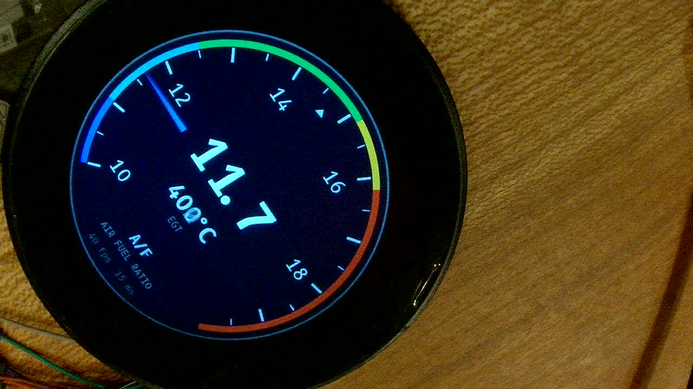
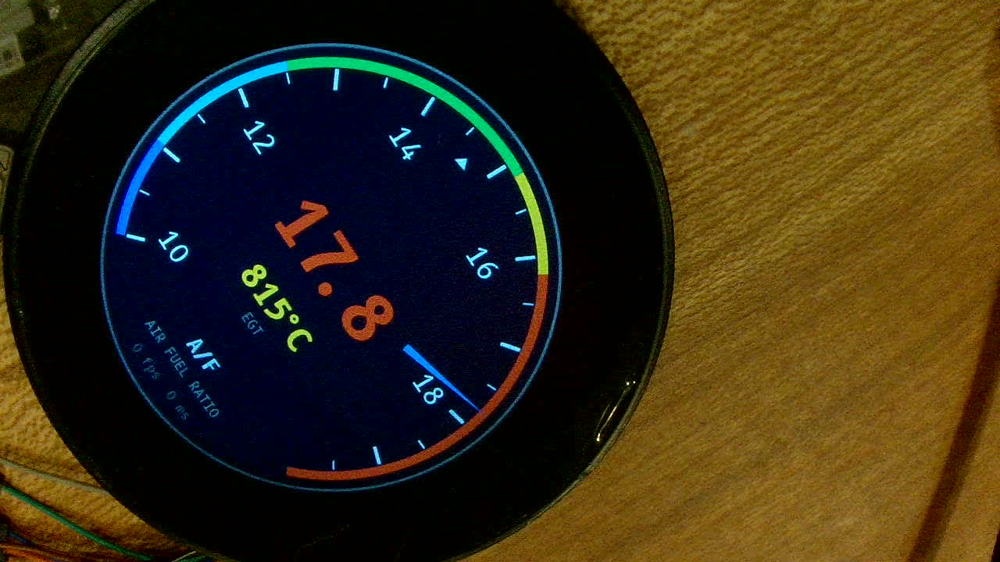
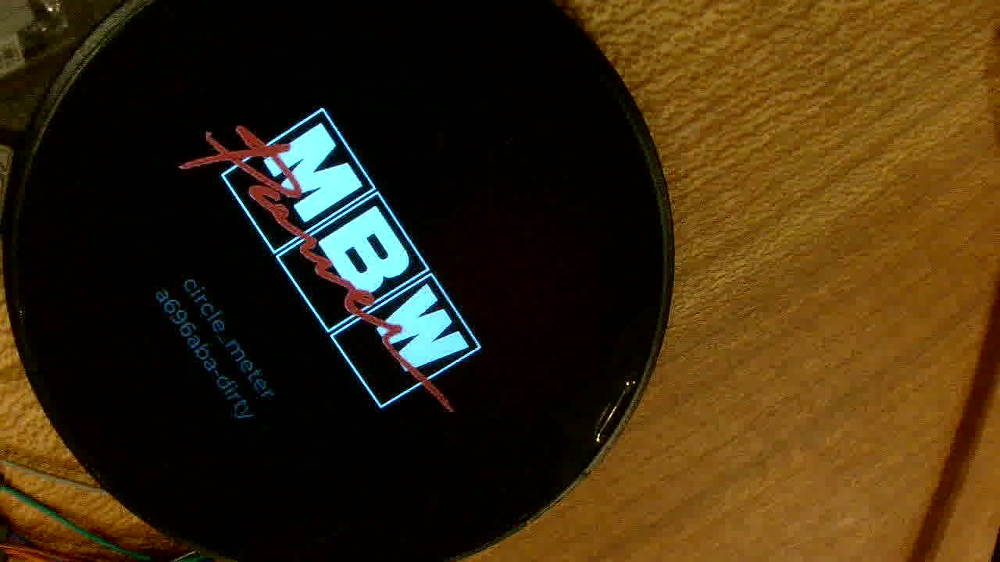

# ユーザー設定の実機確認 2026-10-12（LCD-2.1 / SWR-67）

#10 でマージした配布先ユーザー向けの設定（`user/user_config.h`）・起動ロゴの差し替え・`tools/meter_log.py` の判定を、
マージ後の `main`（`a696aba`）から実機に書き込んで確かめた記録（`SWR-67` / `SWD-14` / `UT-24` の実機確認）。

| 項目 | 値 |
|---|---|
| FW | `main` `a696aba`（`tools/make_logo.py` のプレビュー位置の修正だけ未コミットのため `-dirty`） |
| 書き込み | `./tools/flash.ps1 -Sim` / `./tools/flash.ps1`（COM ポートの自動検出: CH343 = COM10） |
| CAN | PCAN-USB + `tools/pcan_send.py --mode drive`（500 kbps）。Mini CAN の端子台に 12V は入れない |
| 撮影 | UVC カメラ（斜めから撮影しているため画像は約 90° 回転している） |

## 検証用の設定

```c
#define USER_COLOR_NEEDLE  0x00A0FF   // 針を空色に
#define USER_COLOR_DIAL_BG 0x101830   // 盤面を紺に
#define USER_EGT_WARN_C    800        // 既定 850
#define USER_EGT_DANGER_C  900        // 既定 920
#define USER_LAMBDA_RICH_MAX 1.05     // わざと既定の OPTIMAL_MAX（1.03）を越えさせ、起動時に却下させる
```

起動ロゴは `user/logo.png`（黄色の「MY NA8」、透過 PNG）を `python tools/make_logo.py --user` で変換した。

## 結果

| # | 試験 | 結果 | 実測 |
|---|---|---|---|
| 1 | デモ版の起動ログ（`meter_log.py`） | **PASS** | `反映した項目: egt`、`範囲外のため既定値のままの項目: zones`（終了コード 1。想定どおり） |
| 2 | 色の反映 | **PASS** | 針が空色、盤面が紺（下の画像 1）。λ ゾーンは既定の境目のまま（zones が却下されたため） |
| 3 | EGT 警告閾値の反映 | **PASS** | デモを `7` で止めて EGT 815 °C。**黄色（警告）**で表示（既定の 850 °C なら白）（画像 2） |
| 4 | 起動ロゴの差し替え | **PASS** | 再起動中を連続撮影し、「MY NA8」と版数がスプラッシュに出ることを確認（150 枚中 36 枚 ≒ 約 2 秒）。画像は残していない |
| 5 | 車両用・通信速度一致 | **PASS** | `500 kbps`、`OK  CAN 受信: 160 フレーム/秒、λ センサの状態 OK` |
| 6 | 車両用・フレームなし | **PASS** | PCAN 停止で `NG  CAN のフレームが届いていません（受信エラーなし rec=0）` |
| 7 | 車両用・通信速度不一致 | **PASS** | `USER_CAN_BITRATE_KBPS 1000` で `反映した項目: egt can_bitrate`、`1000 kbps`、PCAN 500 kbps に対して `NG  CAN を受信できていません（受信エラー rec=128）… 通信速度が合っていない`。作者の車両で起きた症状（`2026-10-05_vehicle_na8.md`）と同じ |
| 8 | 既定に戻す | **PASS** | `user/` の検証用ファイルを削除して書き込み。`ユーザー設定: なし（既定の表示）`、CAN 160 f/s、終了コード 0。ロゴも既定（MBW）に戻った（画像 3） |







## 見つけたこと

- `make_logo.py --user` のプレビュー（`user/logo_preview.png`）がロゴを画面の真ん中に置いていたが、実際のスプラッシュは
  中央から 16 px 上（`page_splash.cpp`。下に版数を出すため）。プレビューを実際の位置に合わせた。
- 色の設定（`USER_COLOR_*`）はビルド時に埋め込まれるので、起動ログの「反映した項目」には出ない（組として数えるのは
  `applyUserConfig()` が扱う表示・閾値・CAN の設定だけ）。色は画面で確かめる。`docs/user/08_troubleshooting.md` の
  「反映した項目に出ていなければ `// ` が残っている」は色に当てはまらないので注記し、`customize-meter` Skill と
  `meter_log.py` の出力にも「色はここに出ない」と足した。

## 残り

- まっさらな Windows への導入（`setup-meter` の winget の部分）と PowerShell 5.1 での `tools/*.ps1`
