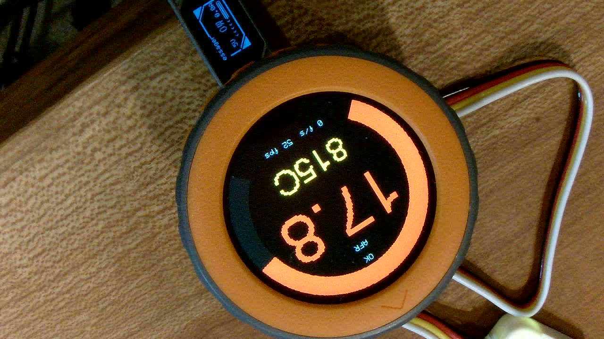
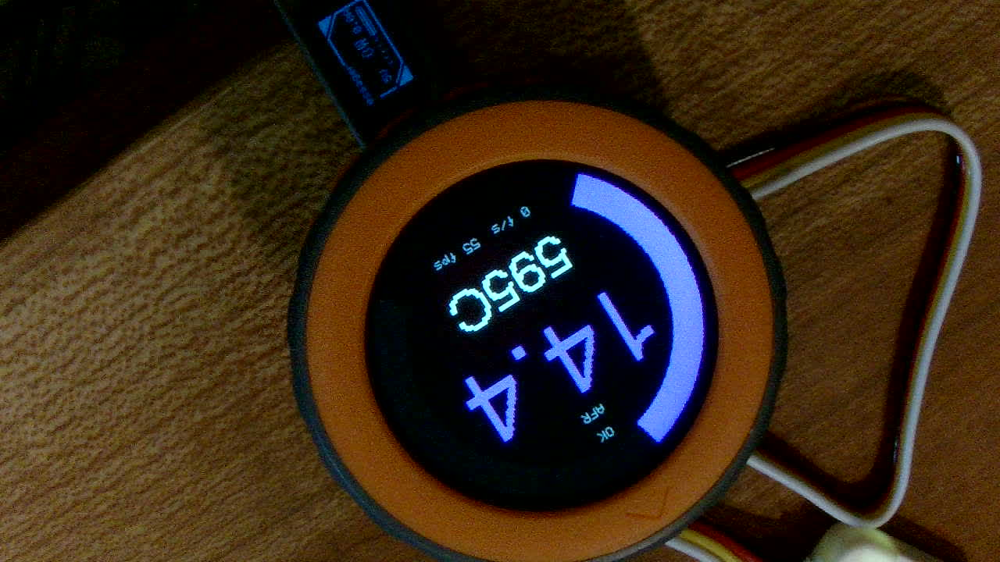
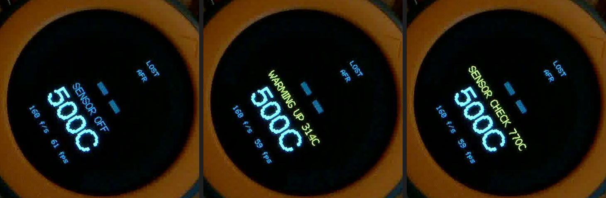
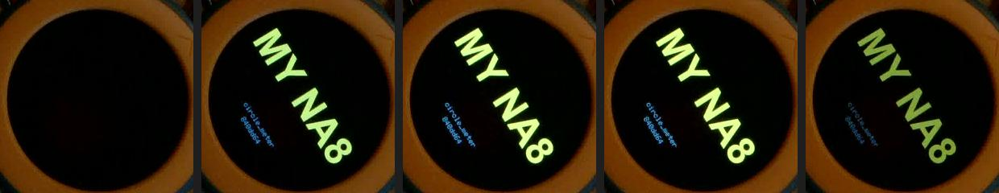
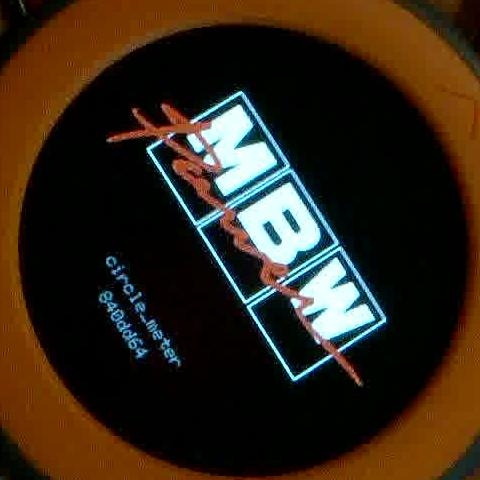

# M5Dial 版の実機確認 2026-10-13（IT-18 / SWR-68）

M5Dial を配布対象に戻した変更（`feat/m5dial-support`、`840dd64`）を M5Stack Dial v1.1 に書き込み、
PCAN ベンチで `IT-18` を行った記録。

| 項目 | 値 |
|---|---|
| FW | `840dd64`（`m5dial` / `m5dial_sim`） |
| 接続 | M5Dial の USB-C（ネイティブ USB、COM7、VID 303A）。Mini CAN を Grove で PORT.A（G13 TX / G15 RX）。Mini CAN の端子台に 12V は入れない |
| CAN | PCAN-USB + `tools/pcan_send.py`（500 kbps） |
| 書き込み | `./tools/flash.ps1 -Board m5dial [-Sim]`（ポートの自動検出: VID 303A） |
| 確認 | `python tools/meter_log.py`（M5Dial を自動で見つけ、`i` で起動ログを出し直させて読む） |
| 撮影 | UVC カメラ（斜めから撮影しているため画像は回転している。今回からユーザーが露出を目視に近づけた） |

## 結果

| # | 試験 | 結果 | 実測 |
|---|---|---|---|
| 1 | 起動ログ（デモ） | **PASS** | `機種: M5Dial`、`デモ`、`反映した項目: egt`、`範囲外のため既定値のままの項目: zones`（検証用にわざと誤らせた λ の境目） |
| 2 | EGT 警告閾値（800 °C） | **PASS** | デモを `7` で止めて `815C` が黄色（画像 1） |
| 3 | 色の設定（`USER_COLOR_OPTIMAL 0xB040FF`） | **PASS** | AFR 14.4 でリングと主数値が紫（画像 2）。**ユーザーが目視でも紫と確認**。設定を外すと緑に戻ることも確認 |
| 4 | 車両用・受信 | **PASS** | `500 kbps base 0x200`、`OK  CAN 受信: 160 フレーム/秒、λ センサの状態 OK` |
| 5 | λ センサの状態（`wbo-warmup`） | **PASS** | シリアル: `NO_SIGNAL -> OFF(25) -> WARMUP(52..) -> CHECK(770) -> OK`。画面: `SENSOR OFF`（灰）/ `WARMING UP 314C`（黄）/ `SENSOR CHECK 770C`（黄）が主数値 `--` と EGT の間に円内で収まる（画像 3） |
| 6 | 信号なし | **PASS** | PCAN 停止後に `NO SIGNAL`（赤） |
| 7 | 起動ロゴの差し替え | **PASS** | `user/logo.png` を `make_logo.py --user` で変換し、スプラッシュに「MY NA8」と版数（画像 4） |
| 8 | 既定に戻す | **PASS** | `user/` の検証用ファイルを削除して書き込み。`ユーザー設定: なし（既定の表示）`、CAN 160 f/s、終了コード 0。既定のロゴ（MBW） |
| 9 | 既定ロゴのジャギー修正 | **PASS** | `assets/logo.cpp` を作り直し（204x86）。スプラッシュで赤い筆記体の縁が黒地に溶け込む（画像 5） |

## 見つけたこと

- **M5Dial（ESP32-S3 のネイティブ USB）を RTS で再起動するには、Windows では RTS を変えた直後に DTR を設定し直す必要がある**
  （usbser ドライバの癖。esptool も同じことをしている）。これをしないと RTS が本体に伝わらず再起動しない。
  `meter_log.py` は M5Dial を再起動せず `i` で起動ログを出し直させる方式にしてあるので、影響はない。
- M5Dial のデモの描画は 52–62 fps（全画面スプライト）。

## 残り

- **LCD-2.1 での退行確認**（このブランチで `main_lcd21.cpp` のデバッグキー・配色の置き場所・スプラッシュのロゴの読み込みを変えた）。
  LCD-2.1 が PC から外れていたため未実施。マージ前に行う
- `OPN-20`: M5Dial の PORT.A へ Mini CAN の 5V を入れて車両で成立するか
