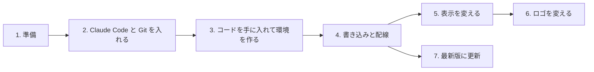

# circle_meter 利用者ガイド

丸型の **空燃比（AFR / λ）・排気温度メータ** を、自分の PC から書き込み、好みの表示に変えるための手順書です。
Git や Claude Code を使ったことがなくても、上から順に進めれば使えるように書いています。

> このガイドは **Windows 11 / 10** 向けです。本体は **Waveshare ESP32-S3-Touch-LCD-2.1**（以下 LCD-2.1）と
> **M5Stack Dial v1.1**（以下 M5Dial）のどちらでも使えます。機種で違うところは、その都度書き分けています。
> 開発者向けの仕様書は [docs/README.md](../README.md) にあります（読まなくても使えます）。

## 全体の流れ

| 順番 | 手順書 | やること | かかる時間 |
|---|---|---|---|
| 1 | [01_prepare.md](01_prepare.md) | 必要な部品・PC・アカウントをそろえる | — |
| 2 | [02_install_claude_git.md](02_install_claude_git.md) | Git と Claude デスクトップアプリを入れ、Claude Code への話しかけ方を知る | 20 分 |
| 3 | [03_get_code.md](03_get_code.md) | メータのプログラムを手に入れ、ビルドできる環境を Claude に作ってもらう | 30 分 |
| 4 | [04_flash_and_wire.md](04_flash_and_wire.md) | デモを書き込んで動作確認 → 車に配線 → 車両用を書き込む | 1 時間 |
| 5 | [05_customize.md](05_customize.md) | 色・警告温度・表示の種類などを変える | 10 分〜 |
| 6 | [06_logo.md](06_logo.md) | 起動時のロゴを自分の画像にする | 10 分 |
| 7 | [07_update.md](07_update.md) | 作者が更新したら最新版を取り込む | 10 分 |

困ったときは [08_troubleshooting.md](08_troubleshooting.md)、言葉が分からないときは [glossary.md](glossary.md) を見てください。

## いちばん大事なこと

- **Claude Code には日本語で頼めば大丈夫です。** 「環境を作って」「デモを書き込んで」「針の色を青にして」のように話しかけます。
- **あなたが変えてよい場所は `user` フォルダだけです。** 設定はすべてそこに置きます。作者の更新を取り込んでも消えません。
- このメータは **表示専用** です。車の CAN にデータを送ることはなく、エンジンの制御には一切関わりません。
  純正メータの代わりではなく、追加のメータとして使ってください。
- 走行中に操作しないでください。設定は停車中に PC から行います。
